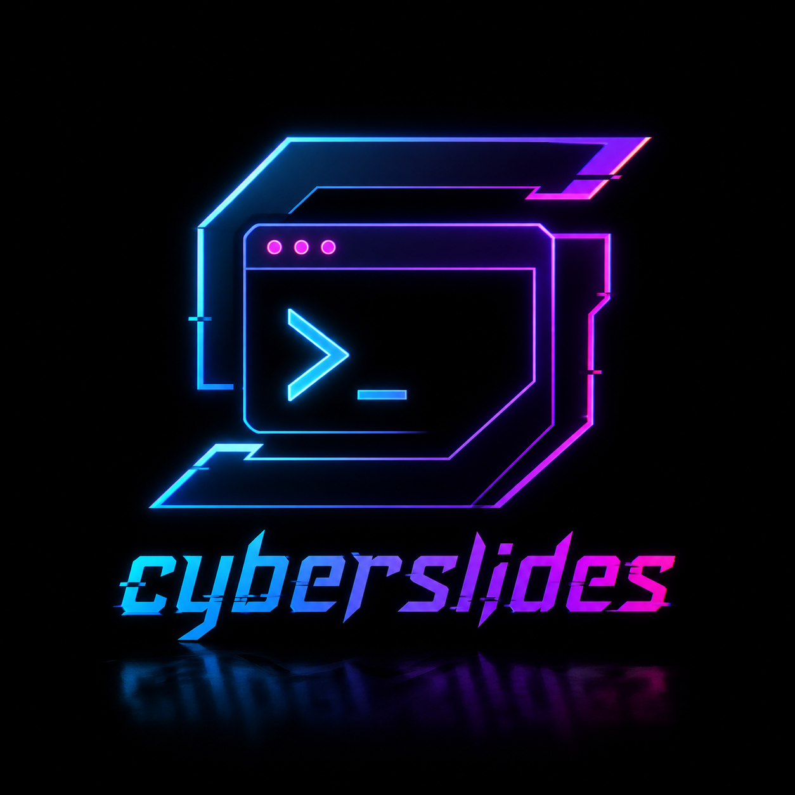

<div align="center">
  
  <p><strong>Local slide decks with real terminals embedded, fast edit/save, and a minimal browser UI.</strong></p>

  <p>
    <a href="#presenting"><strong>Presenting</strong></a> •
    <a href="#editing"><strong>Editing</strong></a> •
    <a href="#quick-start"><strong>Quick Start</strong></a> •
    <a href="#templates"><strong>Templates</strong></a> •
    <a href="#stack"><strong>Stack</strong></a>
  </p>
</div>

> Built for live demos, technical walkthroughs, and slides that need an actual shell.

---

## At a Glance

- Real terminal sessions inside slides.
- Browser-based editing with save-to-disk flow.
- No build step.
- Small stack and easy local debugging.

## Prerequisites

Cyberslides runs locally and only needs a few pieces:

| What | Why | Install |
| --- | --- | --- |
| Node.js 18+ | Runs the server and browser tooling | `node -v` |
| npm | Installs project dependencies | Ships with Node.js |
| Linux build tools | Builds `node-pty` on Linux | `build-essential`, `python3`, `make`, `g++`, `pkg-config` |
| WebSocket-capable browser | Presenter and Edit Mode UI | Recent Chrome, Firefox, or Edge |

The npm dependencies are installed by `npm install`:

- `node-pty`
- `ws`
- `xterm`
- `xterm-addon-fit`

## Quick Start

Copy, paste, run:

```bash
sudo apt update
sudo apt install -y build-essential python3 make g++ pkg-config curl git
npm install
npm start
```

If you are on a different Linux distro, install the same native build prerequisites through your package manager, then run `npm install` and `npm start`.

When the server boots, it prints the local URL, usually:

```text
http://127.0.0.1:8080/
```

## Presenting

Presenter Mode is the live deck.
It keeps the UI out of the way and leaves room for a real shell when a slide needs one.

### What stands out

- Real interactive terminals, not mocked output.
- Fixed terminal geometry on terminal-enabled slides.
- Keyboard navigation and progress dots.
- Clean slide counter for screen sharing.

### Camera mode

Camera mode is controlled from the top bar.
It opens a live camera overlay that can sit on top of the deck while you present.

How to use it:

1. Click `Camera` to open the camera panel.
2. Pick a video source if you want something other than the default camera.
3. Optionally enable microphone permission if you want the camera session to access audio input as well.
4. Choose a position and size for the overlay.
5. Select a mode:
   - `Full output` shows the raw camera feed.
   - `Rounded` shows the feed in a rounded frame.
   - `Only me` uses background separation so only the presenter is visible.
6. Click `Enable` to start the stream.
7. Use the camera button in the top bar to quickly toggle the overlay on and off.

Notes:

- Camera settings are remembered per browser path.
- `Only me` depends on browser camera permission and the embedded segmentation runtime.
- `Esc` still blurs terminal focus when a slide contains an interactive shell.

### Audio player

The audio player lives in the top bar next to the camera and edit controls.
It plays background audio tracks from the local content directory.

How to use it:

1. Add audio files to `content/audio/`.
2. Restart the app if the server is already running so the track list refreshes cleanly.
3. Use the previous, play/pause, and next controls in the top bar.
4. Adjust the volume slider to set the background audio level.

Supported audio formats:

- `.mp3`
- `.wav`
- `.flac`
- `.ogg`
- `.m4a`

The server exposes the track list through `GET /api/audio` and serves the files from `/content/audio/`.

## Editing

Edit Mode is the authoring surface.
You change the draft in the browser, save it back to disk, and the rendered deck updates immediately.

### What stands out

- Edit slide text, type, image state, and metadata.
- Fenced `mermaid` code blocks render as deck-styled diagrams.
- Add, delete, and reorder slides.
- Save through `PUT /api/presentation`.
- Reload after save so disk state and rendered state stay aligned.

## Controls

| Input | Action |
| --- | --- |
| `ArrowRight`, `Space`, `PageDown` | Next slide |
| `ArrowLeft`, `PageUp` | Previous slide |
| `Home`, `End` | First slide, last slide |
| `Esc` | Blur the active terminal |
| Click a dot | Jump to a slide |
| Hover a dot | Show the slide number |
| `Ctrl +`, `Ctrl -`, `Ctrl 0` | Change text size |
| Click a terminal | Focus it |
| `Camera` button | Open camera settings |
| Audio buttons | Previous track, play/pause, next track |

## Templates

| Template | Best for | Terminal | Notes |
| --- | --- | --- | --- |
| `cover` | Title slide | No | Slide 1 only |
| `terminalText` | Short explanation plus shell demo | Yes, right side | Balanced layout for live demos |
| `text` | One focused message | No | Centered and minimal |
| `image` | One visual asset | No | Supports drag, paste, move, and resize |
| `terminalFocused` | Command-heavy walkthrough | Yes, full emphasis | Large terminal-dominant layout |
| `dense` | Evidence, constraints, or comparisons | No | Compact and structured |

## Stack

| Layer | Tech |
| --- | --- |
| Runtime | Node.js |
| Web server | Plain JavaScript HTTP server |
| Terminal bridge | `node-pty` |
| Browser terminal | `xterm` + `xterm-addon-fit` |
| Realtime transport | `ws` |
| UI | Browser JavaScript, HTML, and CSS |

## Project Structure

- `server.js`: HTTP server, markdown rendering, slide normalization, save API, health API, and terminal WebSocket bridge.
- `client.js`: presenter navigation, Edit Mode draft state, save flow, image input, progress dots, and terminal connection.
- `index.template.html`: page shell, slide layout, terminal layout, editor controls, and presentation styling.
- `presentation.config.json`: title, theme, cover metadata, slide content, slide types, image state, and terminal settings.
- `package.json`: runtime commands and dependencies.
- `content/audio/`: optional local audio tracks for the background audio player.

<details>
<summary>API</summary>

`GET /api/health`

Returns server status, slide count, max slide limit, debug mode, and available API paths.

`GET /api/presentation`

Returns normalized `config` and `contentSlides`.

`PUT /api/presentation`

Saves normalized `config` and `contentSlides` back to `presentation.config.json`.

</details>

<details>
<summary>Debugging</summary>

Check the active server:

```bash
curl http://127.0.0.1:8080/api/health
```

Check the editable presentation payload:

```bash
curl http://127.0.0.1:8080/api/presentation
```

Useful failure signals:

- `HTTP 404`: browser is probably talking to an old server process.
- `HTTP 400`: invalid save payload or slide count outside `1-100`.
- `HTTP 413`: image or save payload is too large.
- `HTTP 500`: server could not read or write `presentation.config.json`.

</details>


---

## Attack Path Simulation (initial release)

Cyberslides retains its existing classic presentation at / and adds an optional local
training launcher at /attackpath. Existing presentations remain stored in
presentation.config.json. The new mode creates a distinct on-disk project with a cover,
a scope slide, and ten editable steps for reconnaissance, Shodan intelligence, DNS and
asset validation, Nmap, HTTP fingerprinting, web discovery, Nuclei, attack-path hypotheses,
and an assessment debrief. **The steps are not an autonomous testing agent.** Scan
evidence appears in a collapsible operator panel rather than being automatically
inserted into authored slide text.

The launch page supports named projects, persisted scope, explicitly listed
domains/IPs/CIDRs/URLs, exclusions, limits, and authorization confirmation.
Projects are kept under local attackpath-data/ (excluded from git). Opening a
project uses /?project=ID and the **existing** slide renderer and Edit Mode.

### Scanner adapters

- Shodan: authorized IP, SHODANAPI environment variable; passive lookup.
- Nmap: authorized IP, locally installed nmap; conservative service scan.
- Nuclei: authorized HTTP(S) URL, locally installed nuclei; limited HTTP
  templates, conservative tags, and disabled redirects.
- C3PO: authorized IP or HTTP(S) URL, local C3PO checkout identified by
  C3PO_PATH; JSON research mode with its Nuclei phase disabled.

Optional configuration:

    export C3PO_PATH=/path/to/C3PO-Shodan-codex
    export SHODANAPI=your_key_from_secret_store
    npm start

Every active scan requires authorization confirmation, a non-passive profile,
and an explicit in-scope target. Navigating slides does not start scans.
Running jobs survive browser navigation, can be cancelled, and are marked
interrupted after a server restart. Raw results are bounded and retained
locally. There is no automatic exploitation.

**Scope limitations:** the application checks immediate targets but does not
yet enforce network egress control over internal DNS resolution or all possible
scanner target expansion. For regulated public engagements, apply separate
egress restrictions and review downstream tool behavior. C3PO research mode
performs its own targeted network probes. HTTPx/FFUF automated workflow
orchestration, normalized findings, and automatically generated attack-path
diagrams are future improvements rather than delivered features.

### LAN binding

By default the listener binds to 127.0.0.1. For an authenticated LAN listener:

    export CYBERSLIDES_ACCESS_TOKEN="$(openssl rand -hex 32)"
    HOST=0.0.0.0 PORT=8080 npm start

Open the application at http://YOUR_LAN_IP:8080/attackpath.
The bind address 0.0.0.0 is not a browser URL.

The operator token gives access to privileged editing, scanning and real
terminal sessions. For a read-only viewer role, optionally configure a
different strong CYBERSLIDES_VIEWER_TOKEN. Do not publish the plain HTTP
listener to the internet. Place privileged remote access behind an
authenticated HTTPS/WSS reverse proxy. Login sessions are in memory and
expire after 12 hours.

### Background.png

If background.png exists at root or under project subdirectories, it is
discovered automatically and rendered beneath a dark readability overlay.
Symlinks and generated/hidden directories are excluded. If it is missing,
the existing background style is retained. Interactive per-slide background
editing is not part of this initial release.

### Tests

    npm run check
    npm test

GitHub Actions runs Node tests and an HTTP smoke test. Live public scanning is
intentionally excluded from automated tests.
